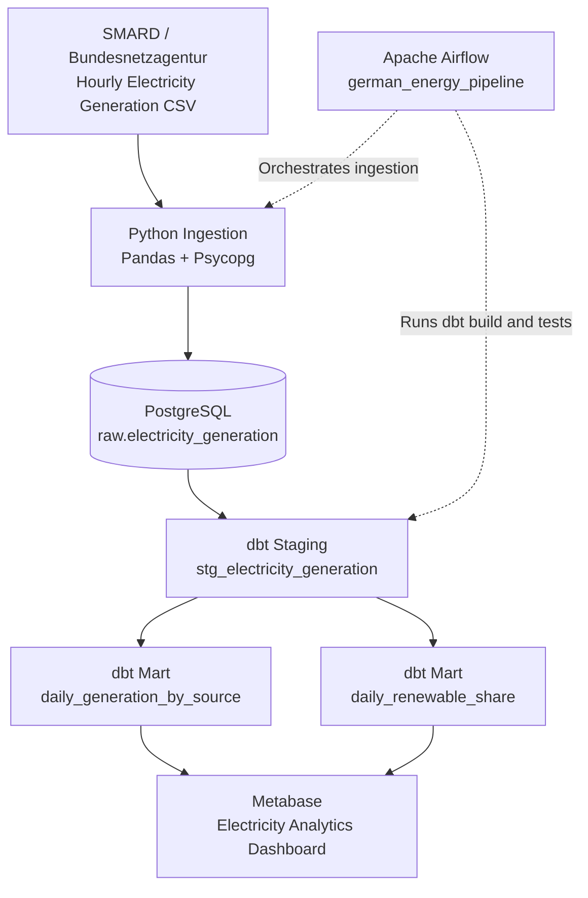

# German Energy Data Platform

An end-to-end data engineering portfolio project that ingests, transforms, tests, and visualizes German electricity generation data.

## Project Overview

This project demonstrates how to build a local data platform for analyzing electricity generation in Germany.

It uses public electricity market data from SMARD (Bundesnetzagentur) to analyze:

- Daily electricity generation by energy source
- Renewable versus non-renewable electricity generation
- Daily renewable energy share
- Data completeness and missing observations

The pipeline processes hourly electricity generation data for January 2024.

## Technology Stack

| Technology | Purpose |
|------------|---------|
| Python | Data ingestion and preprocessing |
| PostgreSQL | Data storage and analytical views |
| dbt | SQL transformations and data quality tests |
| Apache Airflow | Pipeline orchestration |
| Metabase | Interactive analytics dashboard |
| Docker Compose | Local service orchestration |
| Git & GitHub | Version control and portfolio publishing |

## Data Pipeline

1. **Extract:** Load hourly electricity generation data from a SMARD CSV export.
2. **Load:** Ingest the data into PostgreSQL using Python.
3. **Transform:** Build staging and analytics models with dbt.
4. **Test:** Validate source data and transformation results with dbt tests.
5. **Orchestrate:** Run ingestion and dbt transformations through Apache Airflow.
6. **Visualize:** Explore electricity generation trends in Metabase.

## Dataset

**Source:** SMARD — Bundesnetzagentur (German Federal Network Agency)

**Period:** January 1–31, 2024

**Granularity:** Hourly electricity generation by energy source

**Raw records:** 8,928

**Energy sources:** 12

**Daily generation records:** 372

**Daily renewable share records:** 31

The project retains missing observations so data quality issues can be identified rather than silently discarded.

## Architecture

The platform follows a batch-processing architecture using Python, PostgreSQL, dbt, Apache Airflow, and Metabase.



### Pipeline Components

**Data ingestion:** A Python script reads the downloaded SMARD CSV file, transforms it into a normalized format, and loads records into PostgreSQL. The ingestion uses upserts to support repeatable runs.

**Data storage:** PostgreSQL stores the raw electricity generation observations.

**Data transformation:** dbt builds staging and analytics models in the `dbt_dev` schema.

**Data quality:** dbt tests validate source data, model constraints, and renewable share percentages.

**Orchestration:** Apache Airflow executes ingestion followed by `dbt build` through the `german_energy_pipeline` DAG.

**Visualization:** Metabase queries the dbt analytics models to display electricity generation and renewable energy trends.


## Project Structure

```text
german-energy-data-platform/
|
|-- airflow/
|   |-- dags/
|   |   `-- energy_pipeline.py       # Airflow pipeline DAG
|   |-- dbt/
|   |   `-- profiles.yml             # dbt profile for Docker
|   `-- Dockerfile                   # Custom Airflow image
|
|-- energy_dbt/
|   |-- models/
|   |   |-- staging/
|   |   |   |-- _sources.yml
|   |   |   |-- _staging.yml
|   |   |   `-- stg_electricity_generation.sql
|   |   `-- marts/
|   |       |-- _marts.yml
|   |       |-- daily_generation_by_source.sql
|   |       `-- daily_renewable_share.sql
|   |-- tests/
|   |   `-- assert_renewable_share_range.sql
|   `-- dbt_project.yml
|
|-- ingestion/
|   `-- load_generation.py           # CSV ingestion script
|
|-- sql/                              # Initial SQL setup scripts
|-- data/
|   `-- raw/                          # Downloaded CSV (Git-ignored)
|
|-- docker-compose.yaml               # Local infrastructure
|-- requirements.txt                  # Python dependencies
|-- .env.example                      # Example environment variables
|-- .gitignore                        # Git exclusion rules
`-- README.md                         # Project documentation
```

The `data/raw/` directory contains the downloaded SMARD CSV file and is excluded from Git to avoid committing source data.

Generated files such as logs, Python virtual environments, and dbt build artifacts are also excluded.


## Getting Started

### Prerequisites

Install the following tools before running the project:

- Docker Desktop with Docker Compose
- Python 3.12
- Git
- VS Code (recommended)

The instructions below use Windows PowerShell.

### 1. Clone the Repository

```powershell
git clone https://github.com/YOUR_USERNAME/german-energy-data-platform.git
cd german-energy-data-platform
```

Replace `YOUR_USERNAME` with the GitHub username once the repository is published.

### 2. Configure Environment Variables

Copy the example environment file:

```powershell
Copy-Item .env.example .env
```

Open `.env` and replace the placeholder passwords and JWT secret with your own development values.

Ensure the PostgreSQL password is consistent across:

- `DB_PASSWORD`
- `POSTGRES_PASSWORD`
- The password embedded in `AIRFLOW_DB_URL`

The `.env` file is excluded from Git.

### 3. Create a Python Virtual Environment

```powershell
py -3.12 -m venv .venv
.\.venv\Scripts\Activate.ps1
```

Install the Python dependencies:

```powershell
pip install -r requirements.txt
```


### 4. Start the Infrastructure

On a fresh installation, start PostgreSQL first:

```powershell
docker compose up -d postgres
```

Wait until PostgreSQL reports a healthy status:

```powershell
docker compose ps
```

During initialization of a new database volume, PostgreSQL automatically runs the SQL scripts in `docker/postgres/init/`.

These scripts create the separate `airflow_db` database required for Apache Airflow.

Next, start the remaining services:

```powershell
docker compose up -d --build
```

Check the container status:

```powershell
docker compose ps
```

Expected services:

- PostgreSQL — healthy
- Metabase — running
- Airflow API Server — running
- Airflow Scheduler — running
- Airflow DAG Processor — running

The `airflow-init` service may show as exited successfully after initializing the Airflow metadata database.

**Important:** PostgreSQL initialization scripts run only when the database volume is created for the first time. Do not delete existing Docker volumes to repeat initialization, as this would remove stored data.

### 5. Access the Applications

| Application | URL |
|-------------|-----|
| Metabase | http://localhost:3000 |
| Apache Airflow | http://localhost:8080 |
| PostgreSQL | localhost:5433 |

These services run locally using Docker Compose.

**Note:** On a fresh installation, the Airflow metadata database must be initialized before the Airflow services can start successfully. The required initialization procedure is documented below.


## Downloading the Dataset

This project uses publicly available German electricity generation data from **SMARD**, operated by the Bundesnetzagentur (German Federal Network Agency).

**Official website:** https://www.smard.de/en

### Dataset Details

| Property | Value |
|----------|-------|
| Dataset | Actual electricity generation |
| Country | Germany |
| Period | January 1–31, 2024 |
| Resolution | Hourly |
| Format | CSV |
| Energy sources | 12 |
| Expected raw records after ingestion | 8,928 |

### Download Instructions

1. Open the SMARD website.
2. Navigate to the electricity generation data section.
3. Select **Actual Generation** for Germany.
4. Choose the date range **January 1, 2024 to February 1, 2024**.
5. Select **hourly resolution**.
6. Export the data as a CSV file.

Save the downloaded file in:

```text
data/raw/Actual_generation_202401010000_202402010000_Hour.csv
```

Create the `data/raw/` directory if it does not already exist.

The filename matters because the ingestion script expects this file.

### Data Quality Notes

The dataset includes some missing generation values. The pipeline retains missing observations and records them in the dbt analytics models.

The raw CSV is excluded from Git using `.gitignore`, so users must download it separately.


## Running the Data Pipeline

After downloading the SMARD CSV file and starting the Docker services, you can execute the data pipeline.

### Option 1: Run Python Ingestion Manually

Activate your Python virtual environment:

```powershell
.\.venv\Scripts\Activate.ps1
```

Run the ingestion script:

```powershell
python ingestion/load_generation.py
```

The script reads the hourly electricity generation CSV and loads the data into PostgreSQL.

It uses an upsert strategy, allowing repeated executions without creating duplicate records.

### Verify the Ingested Data

Run:

```powershell
docker exec energy_postgres psql -U energy_user -d energy_db -c "SELECT COUNT(*) FROM raw.electricity_generation;"
```

Expected result:

```text
 count
-------
  8928
```

### Option 2: Run the Automated Airflow Pipeline

Open the Airflow interface:

http://localhost:8080

Find the DAG:

`german_energy_pipeline`

Trigger the DAG manually.

The pipeline executes two tasks in sequence:

1. `ingest_generation` — loads the SMARD CSV into PostgreSQL.
2. `dbt_build` — runs dbt models and data quality tests.

Both tasks should complete successfully.

### Verify the dbt Analytics Models

Run:

```powershell
docker exec energy_postgres psql -U energy_user -d energy_db -c "SELECT COUNT(*) FROM dbt_dev.daily_generation_by_source;"
```

Expected result: **372 rows**.

Then run:

```powershell
docker exec energy_postgres psql -U energy_user -d energy_db -c "SELECT COUNT(*) FROM dbt_dev.daily_renewable_share;"
```

Expected result: **31 rows**.

### View the Analytics Dashboard

Open Metabase:

http://localhost:3000

Connect Metabase to PostgreSQL using the database credentials from `.env`.

The analytics models are available in the `dbt_dev` schema.

The dashboard includes:

- Daily Renewable Energy Share — dbt
- Daily Electricity Generation by Source — dbt

**Note:** On a fresh installation, the Metabase dashboard must be created manually because the saved dashboard configuration is not currently exported as part of the repository.
