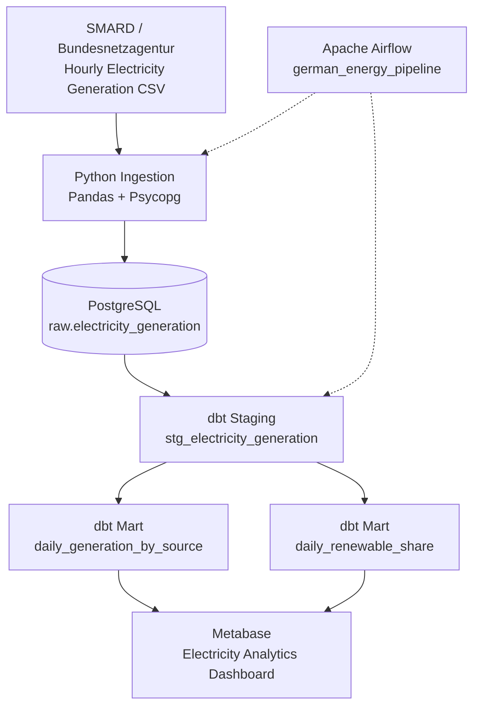

# German Energy Data Platform

An end-to-end data engineering portfolio project that ingests, transforms, tests, and visualizes German electricity generation data using Python, PostgreSQL, dbt, Apache Airflow, Docker, and Metabase.

## Project Overview

This project demonstrates how to build a local batch-processing data platform for analyzing electricity generation in Germany.

It uses publicly available electricity market data from SMARD (Bundesnetzagentur) to analyze:

- Daily electricity generation by energy source
- Renewable versus non-renewable electricity generation
- Daily renewable energy share
- Data completeness and missing observations

The pipeline processes hourly electricity generation data for January 2024.

## Technology Stack

| Technology | Purpose |
|------------|---------|
| Python | Data ingestion and preprocessing |
| Pandas | CSV processing and data transformation |
| PostgreSQL | Raw data storage and analytical views |
| dbt | SQL transformations and data quality tests |
| Apache Airflow | Pipeline orchestration |
| Metabase | Interactive analytics dashboard |
| Docker Compose | Local infrastructure orchestration |
| Git & GitHub | Version control and portfolio publishing |

## Data Pipeline

1. **Extract:** Read hourly electricity generation data from a SMARD CSV export.
2. **Load:** Ingest the data into PostgreSQL using Python and Psycopg.
3. **Transform:** Build staging and analytics models with dbt.
4. **Test:** Validate data quality and transformation results using dbt tests.
5. **Orchestrate:** Execute ingestion and dbt transformations through Apache Airflow.
6. **Visualize:** Explore electricity generation trends in Metabase.

## Dataset

**Source:** SMARD — Bundesnetzagentur (German Federal Network Agency)

**Period:** January 1–31, 2024

**Granularity:** Hourly electricity generation by energy source

**Raw records:** 8,928

**Energy sources:** 12

**Daily generation records:** 372

**Daily renewable share records:** 31

The project retains missing observations so that data quality issues can be identified rather than silently discarded.

## Architecture

The platform follows a batch-processing architecture.



### Pipeline Components

**Data ingestion:** A Python script reads the downloaded SMARD CSV file, transforms it into a normalized format, and loads records into PostgreSQL. The ingestion uses upserts to support repeatable runs.

**Data storage:** PostgreSQL stores hourly electricity generation observations in the `raw.electricity_generation` table.

**Data transformation:** dbt builds staging and analytics models in the `dbt_dev` schema.

**Data quality:** dbt tests validate source data, model constraints, and renewable share percentages.

**Orchestration:** Apache Airflow executes ingestion followed by `dbt build` through the `german_energy_pipeline` DAG.

**Visualization:** Metabase queries dbt analytics models to display electricity generation and renewable energy trends.

## Project Structure

```text
german-energy-data-platform/
|
|-- airflow/
|   |-- dags/
|   |   `-- energy_pipeline.py
|   |-- dbt/
|   |   `-- profiles.yml
|   `-- Dockerfile
|
|-- docker/
|   `-- postgres/
|       `-- init/
|           `-- 01-create-airflow-db.sql
|
|-- energy_dbt/
|   |-- models/
|   |   |-- staging/
|   |   |   |-- _sources.yml
|   |   |   |-- _staging.yml
|   |   |   `-- stg_electricity_generation.sql
|   |   `-- marts/
|   |       |-- _marts.yml
|   |       |-- daily_generation_by_source.sql
|   |       `-- daily_renewable_share.sql
|   |-- tests/
|   |   `-- assert_renewable_share_range.sql
|   `-- dbt_project.yml
|
|-- ingestion/
|   |-- load_generation.py
|   `-- test_connection.py
|
|-- sql/
|   |-- 01_create_schemas.sql
|   |-- 02_create_generation_table.sql
|   |-- 03_data_quality_checks.sql
|   |-- 04_create_staging_view.sql
|   |-- 05_create_daily_generation_mart.sql
|   `-- 06_create_renewable_share_mart.sql
|
|-- data/
|   `-- raw/
|
|-- docker-compose.yaml
|-- requirements.txt
|-- .env.example
|-- .gitignore
`-- README.md
```

The `data/raw/` directory contains the downloaded SMARD CSV file and is excluded from Git.

Generated logs, Python virtual environments, and dbt build artifacts are also excluded.

## Getting Started

### Prerequisites

Install the following tools:

- Docker Desktop with Docker Compose
- Python 3.12
- Git
- Visual Studio Code (recommended)

The following instructions use Windows PowerShell.

### 1. Clone the Repository

```powershell
git clone https://github.com/Datawith-Ramakrishna/german-energy-data-platform.git
cd german-energy-data-platform
```

### 2. Configure Environment Variables

Copy the example environment file:

```powershell
Copy-Item .env.example .env
```

Open `.env` and replace the placeholder passwords and JWT secret with your own development values.

Ensure the PostgreSQL password is consistent across:

- `DB_PASSWORD`
- `POSTGRES_PASSWORD`
- The password embedded in `AIRFLOW_DB_URL`

The `.env` file is excluded from Git.

### 3. Create a Python Virtual Environment

```powershell
py -3.12 -m venv .venv
.\.venv\Scripts\Activate.ps1
```

Install the Python dependencies:

```powershell
python -m pip install -r requirements.txt
```

### 4. Start PostgreSQL

Start PostgreSQL first:

```powershell
docker compose up -d postgres
```

Check the container status:

```powershell
docker compose ps
```

Wait until PostgreSQL reports a healthy status.

On a new PostgreSQL volume, Docker executes the initialization scripts in `docker/postgres/init/`.

The included initialization script creates the separate `airflow_db` database required by Apache Airflow.

### 5. Initialize the Raw Database Tables

Before running ingestion for the first time, create the required schemas and raw electricity generation table.

Run the following commands from the project root:

```powershell
Get-Content .\sql\01_create_schemas.sql | docker exec -i energy_postgres psql -U energy_user -d energy_db -v ON_ERROR_STOP=1
```

```powershell
Get-Content .\sql\02_create_generation_table.sql | docker exec -i energy_postgres psql -U energy_user -d energy_db -v ON_ERROR_STOP=1
```

These scripts prepare PostgreSQL for the ingestion pipeline.

**Note:** These commands assume the default database and username used by this project. If you change them in `.env`, update the commands accordingly.

### 6. Start the Remaining Infrastructure

Run:

```powershell
docker compose up -d --build
```

Check the running containers:

```powershell
docker compose ps
```

Expected services include:

- PostgreSQL
- Metabase
- Airflow API Server
- Airflow Scheduler
- Airflow DAG Processor

The `airflow-init` service may exit successfully after initializing the Airflow metadata database.

**Important:** PostgreSQL initialization scripts run only when a database volume is first created. Do not delete existing Docker volumes unless you intend to remove the stored data.

### 7. Access the Applications

| Application | URL |
|-------------|-----|
| Metabase | http://localhost:3000 |
| Apache Airflow | http://localhost:8080 |
| PostgreSQL | localhost:5433 |

These services run locally using Docker Compose.

## Downloading the Dataset

This project uses publicly available German electricity generation data from **SMARD**, operated by the Bundesnetzagentur.

**Official website:** https://www.smard.de/en

### Dataset Details

| Property | Value |
|----------|-------|
| Dataset | Actual electricity generation |
| Country | Germany |
| Period | January 1–31, 2024 |
| Resolution | Hourly |
| Format | CSV |
| Energy sources | 12 |
| Expected raw records | 8,928 |

### Download Instructions

1. Open the SMARD website.
2. Navigate to the electricity generation data section.
3. Select **Actual Generation** for Germany.
4. Choose the date range **January 1, 2024 to February 1, 2024**.
5. Select **hourly resolution**.
6. Export the data as a CSV file.

Save the downloaded file at:

```text
data/raw/Actual_generation_202401010000_202402010000_Hour.csv
```

If the directory does not exist, create it:

```powershell
New-Item -ItemType Directory -Force -Path data/raw
```

The filename matters because the ingestion script expects this file.

### Data Quality Notes

The dataset contains some missing generation values.

The pipeline retains missing observations and records them in the dbt analytics models.

The raw CSV is excluded from Git, so users must download it separately.

## Running the Data Pipeline

After downloading the SMARD CSV and starting the Docker services, execute the pipeline using either Python or Apache Airflow.

### Option 1: Run Python Ingestion Manually

Activate the Python virtual environment:

```powershell
.\.venv\Scripts\Activate.ps1
```

Run the ingestion script:

```powershell
python ingestion/load_generation.py
```

The script reads the hourly electricity generation CSV and loads the data into PostgreSQL.

It uses an upsert strategy to avoid creating duplicate records during repeated runs.

### Verify the Ingested Data

Run:

```powershell
docker exec energy_postgres psql -U energy_user -d energy_db -c "SELECT COUNT(*) FROM raw.electricity_generation;"
```

Expected result:

```text
 count
-------
  8928
```

### Option 2: Run the Automated Airflow Pipeline

Open Apache Airflow:

http://localhost:8080

Find the DAG:

`german_energy_pipeline`

Trigger the DAG manually.

The pipeline executes two tasks in sequence:

1. `ingest_generation` — loads the SMARD CSV into PostgreSQL.
2. `dbt_build` — runs dbt transformations and data quality tests.

Both tasks should complete successfully.

### Verify the dbt Analytics Models

Check the daily generation model:

```powershell
docker exec energy_postgres psql -U energy_user -d energy_db -c "SELECT COUNT(*) FROM dbt_dev.daily_generation_by_source;"
```

Expected result: **372 rows**.

Check the renewable share model:

```powershell
docker exec energy_postgres psql -U energy_user -d energy_db -c "SELECT COUNT(*) FROM dbt_dev.daily_renewable_share;"
```

Expected result: **31 rows**.

## Data Quality and Testing

The project uses dbt to validate the transformed electricity generation data.

Tests include:

- Source and model constraints
- Required values and uniqueness checks
- Relationships between model fields where defined
- Validation of renewable share percentages

The project also contains a custom SQL test:

```text
energy_dbt/tests/assert_renewable_share_range.sql
```

This test checks that calculated renewable energy percentages remain within the expected range.

The pipeline runs dbt tests as part of:

```bash
dbt build
```

A successful pipeline run confirms that the transformations and their associated tests have completed without errors.

## Analytics Dashboard

The project uses Metabase to visualize the transformed electricity generation data.

Open:

http://localhost:3000

Connect Metabase to PostgreSQL using the credentials configured in `.env`.

For Metabase running inside Docker, use:

| Setting | Value |
|---------|-------|
| Database type | PostgreSQL |
| Host | postgres |
| Port | 5432 |
| Database | energy_db |
| Username | Value of `POSTGRES_USER` |
| Password | Value of `POSTGRES_PASSWORD` |

The dbt analytics models are available in the `dbt_dev` schema.

### Dashboard Visualizations

**Daily Renewable Energy Share — dbt**

Displays the daily percentage of electricity generation from renewable sources.

Model:

```sql
SELECT *
FROM dbt_dev.daily_renewable_share
ORDER BY generation_date;
```

**Daily Electricity Generation by Source — dbt**

Displays daily electricity generation grouped by energy source.

Model:

```sql
SELECT *
FROM dbt_dev.daily_generation_by_source
ORDER BY generation_date, energy_source;
```

**Note:** On a fresh installation, the Metabase dashboard must be created manually because the saved dashboard configuration is not currently exported with the repository.

## Project Highlights

- End-to-end batch data pipeline using open German electricity market data
- Python-based CSV ingestion into PostgreSQL
- Repeatable ingestion using upsert operations
- SQL transformations using dbt staging and mart models
- Automated data quality testing with dbt
- Workflow orchestration using Apache Airflow
- Containerized infrastructure using Docker Compose
- Interactive electricity market analytics using Metabase
- Environment-variable-based configuration
- Version-controlled project structure on GitHub

## Future Improvements

Potential enhancements include:

- Automating data extraction from SMARD
- Supporting incremental ingestion of new electricity generation data
- Adding automated CI checks using GitHub Actions
- Expanding the analysis to additional months and years
- Adding monitoring and failure notifications
- Exporting Metabase dashboard configuration for reproducible deployments
- Adding dashboard screenshots to the repository

## Author

**Ramakrishna**

GitHub: https://github.com/Datawith-Ramakrishna

## Data Source

SMARD — Bundesnetzagentur

https://www.smard.de/en
